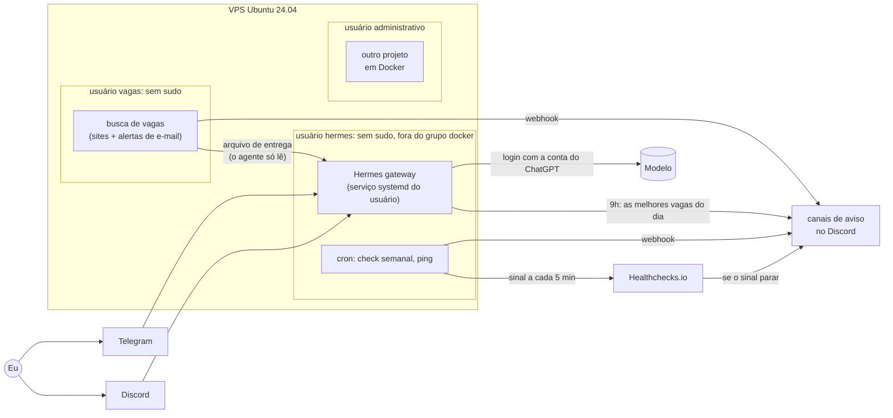

# Hermes na VPS

Como instalei e protegi um assistente de IA pessoal numa VPS Linux que também roda outro projeto em Docker. O agente é o [Hermes Agent](https://github.com/NousResearch/hermes-agent), open source, da Nous Research. Eu não criei o Hermes: o trabalho aqui foi instalar, isolar, restringir e monitorar.

Converso com ele pelo Telegram, recebo os avisos no Discord, e tudo que é tarefa fixa roda em script e cron, sem IA.

## Arquitetura

## Decisões de segurança

| Decisão | Por quê |
| --- | --- |
| Usuário `hermes` próprio, sem sudo e fora do grupo `docker` | O grupo `docker` equivale a root. Assim o agente não instala nada, não mexe nos containers e não consegue nem listar a pasta do outro projeto. |
| Login do modelo pela conta do ChatGPT, não por chave de API | Custo fixo: o próprio plano limita o uso, sem risco de conta alta. |
| Telegram e Discord liberados só para o meu ID | Sem lista de permitidos, qualquer pessoa que achar o bot usa o agente e a minha cota. |
| Bot do Discord privado e sem permissão de administrador | Só eu posso adicionar o bot a um servidor, e ele só vê canais, manda mensagens e reage. |
| Ferramentas desligadas em cada plataforma: terminal, execução de código, navegador, controle do computador, delegação, conexões externas, geração de imagem e voz | Menos superfície de ataque. Também cortou de 16,8 mil para 12,2 mil os tokens enviados em toda mensagem. |
| Memória e skills só gravam com aprovação manual | O agente lê texto de fora (vagas, páginas web). Um texto malicioso que ficasse gravado na memória valeria em todas as conversas. A aprovação de skills veio depois de ver o agente salvar uma skill sem passar pela aprovação da memória. |
| `SOUL.md` com os limites | Ele nunca se candidata, nunca envia mensagem nem paga nada em meu nome, nunca pede senha e nunca inventa experiência em currículo. Exemplo em [`exemplos/SOUL.md`](exemplos/SOUL.md). |
| `.env` com permissão 600 | Tokens e listas de permitidos só são legíveis pelo próprio usuário. As ferramentas de arquivo do Hermes já bloqueiam escrita nele. |
| SSH só com chave, sem senha e sem root, com fail2ban | Login por senha e como root é o que os robôs mais tentam em VPS. A regra fica num arquivo próprio em `sshd_config.d`, e o fail2ban bloqueia quem erra várias vezes. |
| Busca de vagas num usuário `vagas` separado | Ela guarda a senha de app do Gmail para ler os alertas do LinkedIn. Se ficasse no usuário do agente, um texto malicioso lido por ele poderia levar a senha embora. Assim o agente não consegue nem listar a pasta. |
| Triagem diária de vagas com o mínimo de ferramentas | Às 9h uma tarefa agendada do agente lê as vagas do dia, compara com o currículo e manda as melhores no Discord, cada uma com o motivo e o risco. Ela roda só com a ferramenta de arquivos, e o arquivo de vagas fica numa pasta de um grupo em que o agente só tem leitura. A descrição das vagas vem de fora, então o prompt manda ignorar instruções escritas dentro delas. |
| Segredos fora dos comandos | URLs de webhook entram com `read -s` direto num arquivo com permissão 600, sem aparecer na tela nem no histórico. |

## Monitoramento

- **Check semanal** ([`scripts/check_semanal.sh`](scripts/check_semanal.sh)): toda segunda às 9h, um script Bash manda no Discord o uso de disco, memória e swap, as atualizações pendentes, se falta reiniciar e se o gateway está ativo. Avisa em destaque se o disco passar de 80% ou o gateway parar.
- **Disponibilidade:** a cada 5 minutos a VPS manda um sinal para o Healthchecks.io. Se os sinais param, quem avisa no Discord é o Healthchecks, então o aviso chega mesmo com a VPS fora do ar.
- **Agendamentos:** [`exemplos/crontab.exemplo`](exemplos/crontab.exemplo).

## Automações sem IA

- [buscador-de-vagas](https://github.com/Joaoxzx/buscador-de-vagas): procura vagas júnior na Gupy e no GitHub três vezes por dia e manda as novas no Discord.

## Próximos passos

- Limitar onde o agente pode escrever arquivos (`HERMES_WRITE_SAFE_ROOT`), porque hoje ele ainda consegue editar o próprio `config.yaml`.
- Monitorar o outro projeto (rota `/health`, backup do banco e certificado SSL) quando ele for para produção.
