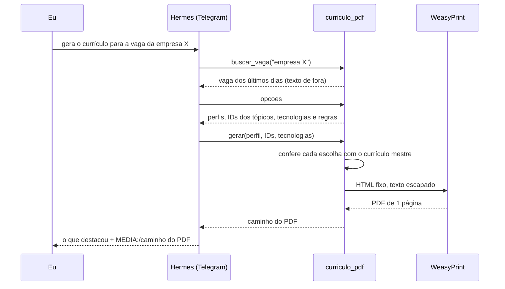
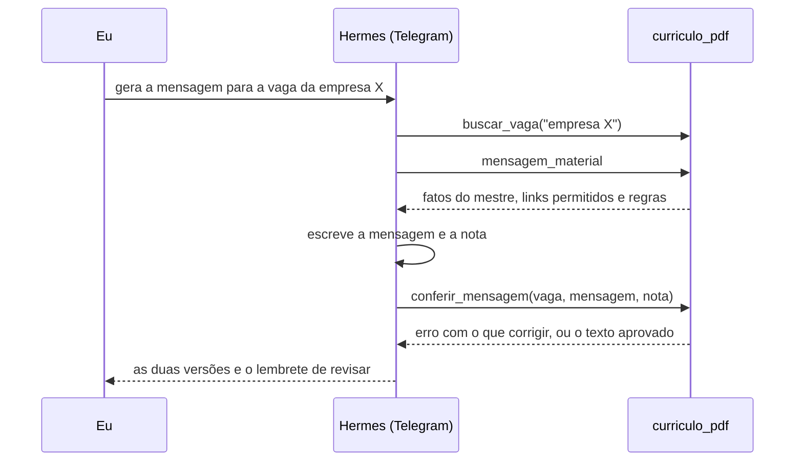

# Plugin `curriculo`: currículo e mensagem ajustados para uma vaga

Peço no Telegram "gera o currículo para a vaga da empresa X" e o PDF chega na conversa, ajustado para a vaga, para eu revisar antes de mandar. A mensagem de candidatura sai pela mesma ferramenta: veja [Mensagem de candidatura](#mensagem-de-candidatura).

O agente não escreve nenhuma frase do currículo. Ele só escolhe:

- o perfil (back-end ou full stack), que define o resumo e o título na experiência;
- quais tópicos de cada experiência entram e em que ordem, pelo ID (`e1.3`, `e2.1`...);
- quais linguagens e tecnologias aparecem e em que ordem.

Todo o texto vem do currículo mestre, um Markdown que fica na VPS, e o visual é um modelo HTML fixo, copiado do meu modelo de currículo: Times New Roman 10 pt, margens laterais de 0,5", títulos de seção de 12 pt centralizados com linha embaixo, empresa em negrito com a cidade em itálico, cargo em negrito e itálico e datas alinhadas à direita.

## Como funciona



A ferramenta tem seis ações:

| Ação | O que faz |
| --- | --- |
| `buscar_vaga` | Procura a vaga pelo nome da empresa ou do cargo no arquivo de vagas dos últimos 3 dias, que o [buscador de vagas](https://github.com/Joaoxzx/buscador-de-vagas) grava numa pasta em que o agente só tem leitura. |
| `opcoes` | Lê o currículo mestre e devolve os dois resumos, os tópicos com ID, as tecnologias e as regras de escolha. |
| `gerar` | Confere as escolhas, monta o HTML, gera o PDF e devolve o caminho. Tecnologia que não está no mestre, ID que não existe, experiência ou projeto sem tópico voltam como erro, e o agente corrige. Se o PDF passar de 1 página, ele é apagado e o agente tira tópicos. |
| `mensagem_material` | Devolve os fatos do mestre (kit de candidatura, objetivo, resumos, competências, experiências e projetos), os links permitidos e as regras da mensagem. |
| `conferir_mensagem` | Confere a mensagem e a nota que o agente escreveu. Só o que passa é gravado em `mensagem.txt`, na mesma pasta do PDF da vaga, e devolvido para ele mostrar. |
| `propor_mestre` | Guarda uma versão nova do currículo mestre como proposta, sem aplicar. Veja abaixo. |

O Hermes manda o arquivo no Telegram quando a resposta do agente tem uma linha `MEDIA:/caminho/do/arquivo.pdf`. O plugin devolve essa linha pronta.

## Mensagem de candidatura

Peço no Telegram "gera a mensagem para a vaga da empresa X" (ou "o currículo e a mensagem") e recebo duas versões para revisar e mandar eu mesmo:

| Versão | Limite | Onde uso |
| --- | --- | --- |
| Mensagem | 600 caracteres | E-mail, InMail ou campo de apresentação da candidatura |
| Nota | 200 caracteres | Convite de conexão do LinkedIn, que tem esse limite sem Premium |

Aqui, ao contrário do currículo, **o agente escreve o texto**. Uma mensagem montada com frases fixas sairia quase igual para toda vaga, e o recrutador percebe. Em troca, nada que ele escreve chega a mim sem passar por uma conferência sem IA:



O que a conferência barra, comparando com o currículo mestre:

| Barra | Exemplo | Por quê |
| --- | --- | --- |
| Tecnologia que não está no mestre | "Java", "PostgreSQL", "React Native" | É a invenção mais provável: dizer que tenho o que a vaga pede. |
| Número que não está no mestre | "2 anos de experiência" | Tempo e resultado inventados. Número colado em nome de empresa, como 99Pay, passa. |
| Termo que o mestre não sustenta | "em produção", "sênior", "formado", "liderei", "fluente" | O sistema da barbearia está em implantação, sou júnior, a faculdade não acabou e o inglês é de leitura. |
| E-mail ou link de fora | `evil.com`, o portfólio em construção | Só passam o LinkedIn e o GitHub do contato. |
| Tamanho | 601 caracteres | Acima do limite de cada versão. |

Um termo da lista passa quando o próprio mestre o tem, então a conferência acompanha o mestre: quando o sistema da barbearia for ao ar e o mestre disser "em produção", a mensagem também pode dizer. Termo que aparece no nome da vaga também passa (a Senior Sistemas é uma empresa).

**A conferência não pega tudo.** Frase genérica que não é fato verificável ("resolvo problemas complexos") passa. Por isso o agente sempre lembra de revisar antes de enviar, e quem envia sou eu.

## Atualizar o currículo mestre pela conversa

Quando conto um projeto novo ou um detalhe do sistema, o agente propõe a mudança no currículo mestre, mas não consegue aplicar. Quem aplica sou eu, com o comando `/mestre` no Telegram:

| Comando | O que faz |
| --- | --- |
| `/mestre` | Mostra o que entra (`+`) e o que sai (`-`) do currículo mestre, e um código de 6 caracteres. |
| `/mestre aplicar <código>` | Aplica a proposta e guarda a versão anterior em `~/curriculos/mestre-backups/`. |
| `/mestre descartar` | Apaga a proposta. |

A diferença é calculada pelo plugin, não escrita pelo agente, então o que aparece no `/mestre` é exatamente o que vai mudar. O código garante que eu aplico a mesma versão que vi: se o agente trocar a proposta depois, o código muda. Uma proposta fora do formato do mestre nem chega a ser guardada.

## Decisões de segurança

| Decisão | Por quê |
| --- | --- |
| O agente escolhe IDs; o texto e o visual são fixos | A descrição da vaga vem de fora e pode ter instruções escondidas. Mesmo que o agente seja enganado por ela, o pior resultado é um currículo com fatos verdadeiros numa ordem ruim. Ele não consegue inventar experiência nem colocar HTML no PDF. |
| Uma ferramenta própria em vez de liberar terminal ou execução de código | O agente continua sem terminal. O plugin faz uma coisa só, com entradas conferidas. |
| WeasyPrint num processo separado, com o Python do sistema | O processo que gera o PDF não recebe as variáveis de ambiente do gateway (tokens) e recusa qualquer URL no HTML. |
| Mensagem escrita pelo agente, mas conferida sem IA antes de chegar a mim | A mensagem precisa soar como uma pessoa falando da vaga, então frases fixas não serviam. O risco é ele inventar o que a vaga pede; a conferência barra tecnologia, número, termo e link que o mestre não sustenta, e o envio continua sendo meu. |
| Mudança no currículo mestre só com `/mestre aplicar` | O agente lê vagas de fora. Se ele pudesse editar o mestre direto, uma instrução escondida numa vaga poderia colocar uma experiência falsa lá, e ela iria para todos os currículos seguintes. Comandos com `/` só chegam de mensagens minhas, então o agente não consegue aprovar sozinho. |
| Código do plugin com dono `root` | O usuário do agente lê e executa o plugin, mas não consegue alterar o código. |
| Ferramenta ligada só no Telegram | É onde peço o currículo. O Discord só recebe avisos. |

## Por que WeasyPrint

A VPS tem 3,8 GB de RAM e já roda o gateway do Hermes e outro projeto em Docker.

| Opção | Resultado |
| --- | --- |
| Chromium headless | No Ubuntu 24.04 só vem como snap, que não lê pastas ocultas como `~/.hermes`, e usa centenas de MB por PDF. |
| wkhtmltopdf | Sem manutenção há anos e sem suporte a flexbox, que o layout usa. |
| **WeasyPrint** | Vem no apt (`weasyprint` 61.1), gera o PDF em meio segundo e usa uns 70 MB. |

A fonte é a Liberation Serif (`fonts-liberation`), que tem as mesmas medidas da Times New Roman. Medi o modelo linha por linha e recriei o topo dele em HTML: as quebras de linha ficaram iguais e o espaçamento ficou a menos de meio ponto do original.

## Formato do currículo mestre

O plugin lê `~/vagas/curriculo-mestre.md` e usa só estas seções. O resto (Objetivo, Kit de candidatura, Pendências) nunca entra no PDF.

```markdown
## Contato
- Nome: Fulano de Tal
- Cidade: Cidade, UF
- Telefone: ...
- E-mail: ...
- LinkedIn: ...
- GitHub: ...
- Portfólio: site.dev (em construção)   <- com parênteses, não entra

## Resumo por tipo de vaga
### Back-end
Título na experiência: Desenvolvedor Back-end (Freelancer)
Parágrafo do resumo.
### Full stack
Título na experiência: Desenvolvedor Full Stack (Freelancer)
Parágrafo do resumo.

## Competências técnicas
- Linguagens: ...          <- linha "Linguagens"
- Back-end: ...            <- todas as outras viram "Tecnologias"
- Idiomas: ...             <- linha "Idiomas", sempre inteira

## Experiência
### Empresa | Cidade, UF | mês ano – atual             <- sem cargo: usa o título do perfil
### Empresa | Cargo | Cidade, UF | mês ano – mês ano
- tópico, com **negrito** onde quiser destacar
Texto solto vira observação para o agente, não entra no PDF.

## Formação
- Instituição | Curso | mês ano – mês ano (previsão)  <- sem cidade: usa a do contato

## Projetos pessoais
### Nome do projeto (mês ano – atual)   <- só entra projeto com data no título
Descrição curta.
- tópico
```

## Instalação

Pacotes do sistema, com o usuário administrativo:

```bash
sudo apt install -y weasyprint fonts-liberation
```

Código do plugin dentro do Hermes, com dono `root`:

```bash
sudo -u hermes mkdir -p /home/hermes/.hermes/plugins
sudo install -d -o root -g root -m 755 /home/hermes/.hermes/plugins/curriculo
sudo install -o root -g root -m 644 plugins/curriculo/*.py plugins/curriculo/plugin.yaml /home/hermes/.hermes/plugins/curriculo/
```

Teste sem IA, com o usuário do agente:

```bash
python3 ~/.hermes/plugins/curriculo/teste.py opcoes
python3 ~/.hermes/plugins/curriculo/teste.py gerar
python3 ~/.hermes/plugins/curriculo/teste.py mensagem
python3 ~/.hermes/plugins/curriculo/teste.py conferir "Tenho 2 anos de experiência com Java." "Olá!"
```

O último deve voltar com erro apontando o número, o tempo de experiência e o Java.

Ligar o plugin só no Telegram e reiniciar o gateway:

```bash
hermes plugins enable curriculo
hermes tools disable curriculo --platform discord
hermes gateway restart
```

Regra no `SOUL.md` para o agente usar a ferramenta (veja abaixo por quê), no fim da lista de limites:

```markdown
Currículo:
- Para currículo de uma vaga, use sempre a ferramenta curriculo_pdf (se ela não aparecer, ache com tool_search). Ela gera o PDF; nunca escreva o currículo você mesmo em texto ou Markdown.
- Quando eu contar algo novo para o currículo, proponha a mudança com curriculo_pdf (acao propor_mestre). Nunca edite o currículo mestre direto.
- Para a mensagem de candidatura de uma vaga, use curriculo_pdf (acao mensagem_material e depois conferir_mensagem) e me mostre só o que passou na conferência.
```

## O que aprendi no primeiro teste

Na primeira vez, o agente ignorou a ferramenta e escreveu um currículo em Markdown por conta própria. O motivo é o Tool Search do Hermes, que vem ligado: ferramentas de plugin não ficam visíveis para o modelo, só aparecem como uma linha num catálogo, e ele precisa buscar a ferramenta antes de usar. O plugin não tem como pedir para ficar sempre visível.

Desligar o Tool Search resolveria, mas toda mensagem passaria a carregar mais esquemas de ferramentas. Preferi a regra no `SOUL.md`: com ela, o agente buscou a ferramenta e gerou o PDF já na segunda tentativa.

O teste também mostrou o `HERMES_WRITE_SAFE_ROOT` funcionando: o agente tentou gravar o currículo em Markdown fora da pasta de rascunhos e foi bloqueado.
