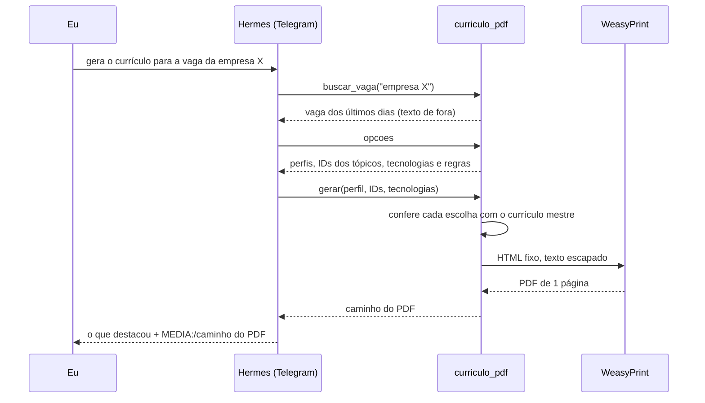

# Plugin `curriculo`: currículo ajustado para uma vaga

Peço no Telegram "gera o currículo para a vaga da empresa X" e o PDF chega na conversa, ajustado para a vaga, para eu revisar antes de mandar.

O agente não escreve nenhuma frase do currículo. Ele só escolhe:

- o perfil (back-end ou full stack), que define o resumo e o título na experiência;
- quais tópicos de cada experiência entram e em que ordem, pelo ID (`e1.3`, `e2.1`...);
- quais linguagens e tecnologias aparecem e em que ordem.

Todo o texto vem do currículo mestre, um Markdown que fica na VPS, e o visual é um modelo HTML fixo, o mesmo dos currículos que fiz no Word: A4, Calibri 9,5 pt, títulos de seção centralizados com linha embaixo, datas e cidades alinhadas à direita.

## Como funciona



A ferramenta tem três ações:

| Ação | O que faz |
| --- | --- |
| `buscar_vaga` | Procura a vaga pelo nome da empresa ou do cargo no arquivo de vagas dos últimos 3 dias, que o [buscador de vagas](https://github.com/Joaoxzx/buscador-de-vagas) grava numa pasta em que o agente só tem leitura. |
| `opcoes` | Lê o currículo mestre e devolve os dois resumos, os tópicos com ID, as tecnologias e as regras de escolha. |
| `gerar` | Confere as escolhas, monta o HTML, gera o PDF e devolve o caminho. Tecnologia que não está no mestre, ID que não existe ou experiência sem tópico voltam como erro, e o agente corrige. Se o PDF passar de 1 página, ele é apagado e o agente tira tópicos. |

O Hermes manda o arquivo no Telegram quando a resposta do agente tem uma linha `MEDIA:/caminho/do/arquivo.pdf`. O plugin devolve essa linha pronta.

## Decisões de segurança

| Decisão | Por quê |
| --- | --- |
| O agente escolhe IDs; o texto e o visual são fixos | A descrição da vaga vem de fora e pode ter instruções escondidas. Mesmo que o agente seja enganado por ela, o pior resultado é um currículo com fatos verdadeiros numa ordem ruim. Ele não consegue inventar experiência nem colocar HTML no PDF. |
| Uma ferramenta própria em vez de liberar terminal ou execução de código | O agente continua sem terminal. O plugin faz uma coisa só, com entradas conferidas. |
| WeasyPrint num processo separado, com o Python do sistema | O processo que gera o PDF não recebe as variáveis de ambiente do gateway (tokens) e recusa qualquer URL no HTML. |
| Código do plugin com dono `root` | O usuário do agente lê e executa o plugin, mas não consegue alterar o código. |
| Ferramenta ligada só no Telegram | É onde peço o currículo. O Discord só recebe avisos. |

## Por que WeasyPrint

A VPS tem 3,8 GB de RAM e já roda o gateway do Hermes e outro projeto em Docker.

| Opção | Resultado |
| --- | --- |
| Chromium headless | No Ubuntu 24.04 só vem como snap, que não lê pastas ocultas como `~/.hermes`, e usa centenas de MB por PDF. |
| wkhtmltopdf | Sem manutenção há anos e sem suporte a flexbox, que o layout usa. |
| **WeasyPrint** | Vem no apt (`weasyprint` 61.1), gera o PDF em meio segundo e usa uns 70 MB. |

A fonte é a Carlito (`fonts-crosextra-carlito`), que tem as mesmas medidas da Calibri. Comparei o PDF do WeasyPrint com o que o Chrome gerou com Calibri no Windows: as quebras de linha e o espaçamento ficaram iguais.

## Formato do currículo mestre

O plugin lê `~/vagas/curriculo-mestre.md` e usa só estas seções. O resto (Objetivo, Kit de candidatura, Pendências) nunca entra no PDF.

```markdown
## Contato
- Nome: Fulano de Tal
- Cidade: Cidade, UF
- Telefone: ...
- E-mail: ...
- LinkedIn: ...
- GitHub: ...
- Portfólio: site.dev (em construção)   <- com parênteses, não entra

## Resumo por tipo de vaga
### Back-end
Título na experiência: Desenvolvedor Back-end (Freelancer)
Parágrafo do resumo.
### Full stack
Título na experiência: Desenvolvedor Full Stack (Freelancer)
Parágrafo do resumo.

## Competências técnicas
- Linguagens: ...          <- linha "Linguagens"
- Back-end: ...            <- todas as outras viram "Tecnologias"
- Idiomas: ...             <- linha "Idiomas", sempre inteira

## Experiência
### Empresa | Cidade, UF | mês ano – atual             <- sem cargo: usa o título do perfil
### Empresa | Cargo | Cidade, UF | mês ano – mês ano
- tópico
Texto solto vira observação para o agente, não entra no PDF.

## Formação
- Instituição | Curso | mês ano – mês ano (previsão)  <- sem cidade: usa a do contato

## Projetos pessoais
### Nome do projeto (mês ano – atual)   <- só entra projeto com data no título
Descrição curta.
- tópico
```

## Instalação

Pacotes do sistema, com o usuário administrativo:

```bash
sudo apt install -y weasyprint fonts-crosextra-carlito
```

Código do plugin dentro do Hermes, com dono `root`:

```bash
sudo -u hermes mkdir -p /home/hermes/.hermes/plugins
sudo install -d -o root -g root -m 755 /home/hermes/.hermes/plugins/curriculo
sudo install -o root -g root -m 644 plugins/curriculo/*.py plugins/curriculo/plugin.yaml /home/hermes/.hermes/plugins/curriculo/
```

Teste sem IA, com o usuário do agente:

```bash
python3 ~/.hermes/plugins/curriculo/teste.py opcoes
python3 ~/.hermes/plugins/curriculo/teste.py gerar
```

Ligar o plugin só no Telegram e reiniciar o gateway:

```bash
hermes plugins enable curriculo
hermes tools disable curriculo --platform discord
hermes gateway restart
```
